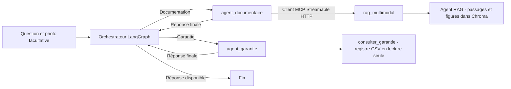

# TP5 · Agentic AI, LangChain, LangGraph et MCP

**Atelier SAV** est un prototype d’assistance pour un distributeur d’appareils électroniques. Il couvre les parties A à D de l’activité de Mohamed Youssfi. Les manuels, la photo et le registre de garantie constituent un corpus fictif fourni avec le projet.

| Partie | Réalisation | Où la lancer |
| --- | --- | --- |
| A · LangChain | Agent simple, mémoire, estimation locale, DuckDuckGo, Tavily, PythonREPLTool, middlewares et chatbot RAG | `TP5_Demonstrations.ipynb`, sections A |
| B · LangGraph | Boucle avec état typé et checkpoints, chatbot Agentic RAG, configuration Studio et interface web | `tp5/b_bases.py`, `tp5/b_rag.py`, `langgraph.json`, `app_streamlit.py` |
| C · MCP | Serveur à deux outils, MCP Inspector, agent LangChain et workflow n8n | `tp5/c_server.py`, `tp5/c_agent.py`, `n8n/agent_sav_mcp.json` |
| D · Synthèse | Orchestrateur LangGraph, outil distant `rag_multimodal` et registre local de garantie | `tp5/d_orchestrateur.py`, `tp5/d_server.py`, `tp5/d_garantie.py` |

## 1. Installation

Installez les dépendances depuis la racine du projet avec Python 3.12 et uv. [Installation de uv](https://docs.astral.sh/uv/)

```powershell
uv sync --locked --python 3.12
Copy-Item .env.example .env
```

La partie A et les agents LLM de la partie C utilisent Ollama. Démarrez-le avant de télécharger les deux modèles ci-dessous. [Télécharger Ollama](https://ollama.com/)

```powershell
ollama pull qwen2.5:1.5b
ollama pull qwen3-vl:2b-instruct
```

Les graphes B et D fonctionnent localement sans clé et sans LLM par défaut. Tavily nécessite une clé `TAVILY_API_KEY` dans `.env`. DuckDuckGo dépend de l’accès réseau. Les fichiers du corpus sont déjà fournis. On peut les régénérer avec `uv run python -m tp5.fixtures`.

## 2. Partie A · Démonstrations LangChain

Ouvrez `TP5_Demonstrations.ipynb` dans VS Code ou Jupyter avec le noyau `.venv`. Exécutez les cellules A dans l’ordre. Les deux appels au même `thread_id` illustrent la mémoire conversationnelle. Le profil d’exécution modifie le prompt. Le sélecteur de modèle bascule vers le modèle avancé si l’historique utilisateur dépasse 280 caractères ou si le profil le demande.

Pour le devis de 120 + 80 MAD, observez `__interrupt__` et reprenez le même fil avec `Command` après validation. Le garde-fou intercepte les chaînes qui ressemblent à une clé privée. Le middleware d’erreur transforme les échecs d’outils en messages exploitables. PythonREPLTool est enveloppé par une validation d’expression arithmétique et requiert une approbation lorsqu’il est appelé par l’agent.

Le chatbot documentaire cherche une preuve dans le corpus. Si le petit modèle tente de répondre sans preuve, un middleware déclenche la recherche. La sortie reprend le passage et sa référence.

## 3. Partie B · LangGraph, Studio et Streamlit

```powershell
uv run python -m tp5.b_bases
uv run langgraph dev --no-reload
```

Ouvrez le lien **Studio UI** affiché par la seconde commande, connectez-vous à LangSmith si demandé et sélectionnez le graphe `agentic_rag`. Créez un fil, puis envoyez les messages du tableau dans l’ordre.

| Message | Trace à observer |
| --- | --- |
| `Bonjour` | `decider → END` |
| `PX-200 : que signifie P02 ?` | `decider → demander_recherche → outils → repondre`. Source attendue, page 1 |
| `Et si internet est coupé ?` | Après la première recherche, `reformuler → demander_recherche → outils → repondre`. Le contexte conserve PX-200 et la seconde recherche retrouve W14, page 3 |

La sélection des branches, la reformulation et la restitution sont explicites dans le graphe B2. La récupération vectorielle de démonstration utilise Chroma et des mots-clés normalisés projetés dans un espace fixe. La réponse est extractive et cite le manuel, la page et la figure correspondante.

La commande Streamlit affiche l’URL locale à ouvrir dans votre navigateur.

```powershell
uv run streamlit run app_streamlit.py
```

Les deux parcours sont accessibles dans la barre latérale. Pour le parcours avec photo, démarrez aussi le serveur du §5.

## 4. Partie C · MCP, Inspector et n8n

Gardez le serveur MCP actif dans un terminal dédié pendant les essais.

```powershell
uv run python -m tp5.c_server
```

Avec Node.js installé, exécutez ces vérifications dans un autre terminal.

```powershell
npx -y @modelcontextprotocol/inspector --cli http://127.0.0.1:8001/mcp --method tools/list
npx -y @modelcontextprotocol/inspector --cli http://127.0.0.1:8001/mcp --method tools/call --tool-name estimer_devis --tool-arg pieces=120 main_oeuvre=80
npx -y @modelcontextprotocol/inspector --cli http://127.0.0.1:8001/mcp --method tools/call --tool-name horaires_sav
uv run python -m tp5.c_agent "Appelle horaires_sav. Quels sont les horaires d'ouverture ?"
```

Les outils attendus sont `estimer_devis` et `horaires_sav`. Les réponses de référence sont **200 MAD** et **09 h 00–17 h 30, du lundi au vendredi**. Pour Inspector en mode graphique, lancez `npx -y @modelcontextprotocol/inspector`, sélectionnez **Streamable HTTP**, puis connectez `http://127.0.0.1:8001/mcp`.

### Agent n8n avec Docker Desktop

Le workflow connecte un déclencheur Chat, un AI Agent, un modèle Ollama et le nœud MCP Client Tool en **HTTP Streamable**. Docker Compose démarre une instance du même serveur MCP sur son réseau interne. Le modèle est servi par Ollama sur la machine hôte.

```powershell
docker compose up -d --build mcp
docker compose run --rm -T n8n import:credentials --input=/tp5/ollama_local.example.json
docker compose run --rm -T n8n import:workflow --input=/tp5/agent_sav_mcp.json
docker compose run --rm -T n8n execute --id=TP5SAVAgentMCP01
docker compose up -d n8n
```

Ouvrez `http://127.0.0.1:5678`, créez votre compte propriétaire local si demandé et ouvrez **TP5 — Agent SAV avec MCP**. Dans le chat de test, envoyez `Appelle horaires_sav. Quels sont les horaires du SAV ?`. Inspectez l’appel MCP dans les détails de l’exécution. Le fichier de credential d’exemple contient uniquement l’adresse d’Ollama. Pour une installation n8n sans Docker, importez le workflow, sélectionnez un credential Ollama à `http://127.0.0.1:11434` et remplacez l’endpoint MCP par `http://127.0.0.1:8001/mcp`.

## 5. Partie D · Synthèse SAV



Le routeur sélectionne un seul agent. Si une demande mélange les deux catégories, la mention explicite de la garantie est prioritaire. Chaque spécialiste renvoie sa réponse à l’orchestrateur, qui termine alors l’exécution.

L’agent documentaire appelle `rag_multimodal` à distance. Le service extrait les passages, les légendes et les images des PDF. Il compare la photo aux pictogrammes extraits, puis exploite la question et les indices visuels pour retrouver un passage et une figure. Cette comparaison locale est adaptée à un écran clair et aux pictogrammes du corpus. Pour des photos plus variées, `ENABLE_OLLAMA_VISION=true` active une description visuelle Ollama si aucun pictogramme ne correspond. La décision et les consignes restent ancrées sur les manuels.

Lancez le serveur documentaire dans un terminal et laissez-le actif pendant les essais.

```powershell
uv run python -m tp5.d_server
```

Exécutez les deux exemples depuis un autre terminal.

```powershell
uv run python -m tp5.d_orchestrateur "Mon imprimante PX-200 affiche un voyant clignotant. Que signifie le pictogramme sur la photo jointe ?" --photo-ref img_px200_01
uv run python -m tp5.d_orchestrateur "Est-ce que mon imprimante est encore sous garantie ? Son numéro de série est PX200-0042."
```

| Demande | Catégorie et agent | Résultat attendu |
| --- | --- | --- |
| Photo `img_px200_01` | `documentation` · `agent_documentaire` | Bourrage papier P02, manuel PX-200, page 1, figure 1 |
| Série `PX200-0042` | `garantie` · `agent_garantie` | Garantie active jusqu’au 11/02/2028 pendant la période couverte |
| Série `PX200-9999` | `garantie` · `agent_garantie` | Numéro absent du registre |

`--photo data/photos/img_px200_01.png` transmet les octets de la photo comme le téléversement Streamlit. Sur chaque trace, l’orchestrateur apparaît au début et au retour du spécialiste.

## 6. Vérifications

Avec les serveurs MCP C et D actifs, lancez `uv run python verification.py`. Ce script vérifie le graphe B1, les recherches avec reformulation, les deux outils MCP, le routage exclusif, la photo par référence et par octets, les garanties et les deux parcours Streamlit.

### Références

- Supports et notebooks de cours de Mohamed Youssfi. [Démo MCP](https://github.com/mohamedYoussfi/mcp-demo) · [RAG comme outil MCP](https://github.com/mohamedYoussfi/agent-rag-as-tool-mcp-v2)
- Documentation officielle. [Middlewares LangChain](https://docs.langchain.com/oss/python/langchain/middleware/custom) · [LangGraph Studio](https://docs.langchain.com/langsmith/quick-start-studio) · [MCP Inspector](https://modelcontextprotocol.io/docs/tools/inspector) · [MCP Client Tool n8n](https://docs.n8n.io/integrations/builtin/cluster-nodes/sub-nodes/n8n-nodes-langchain.toolmcp)

